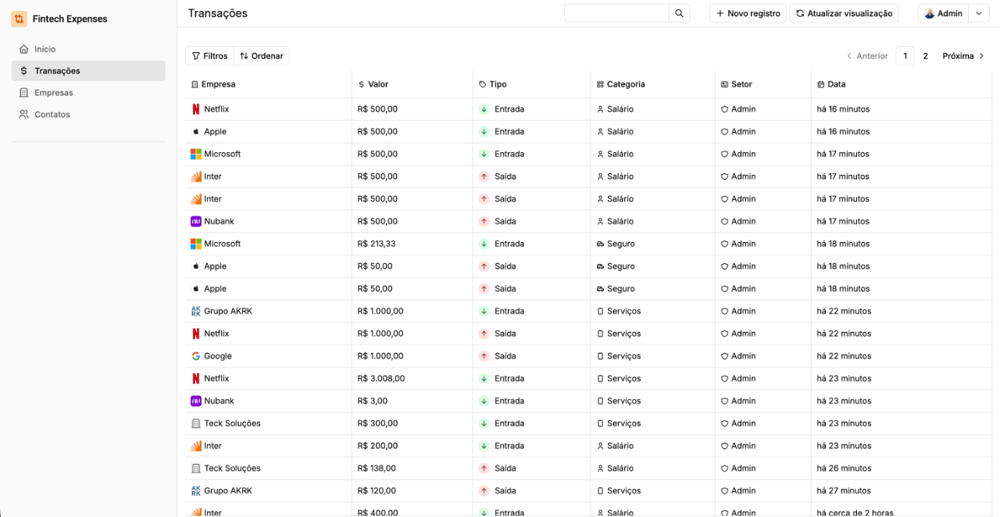
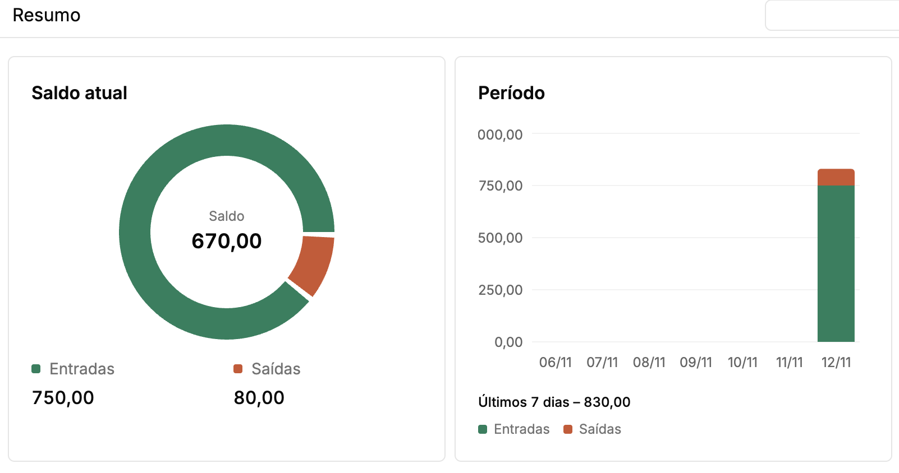
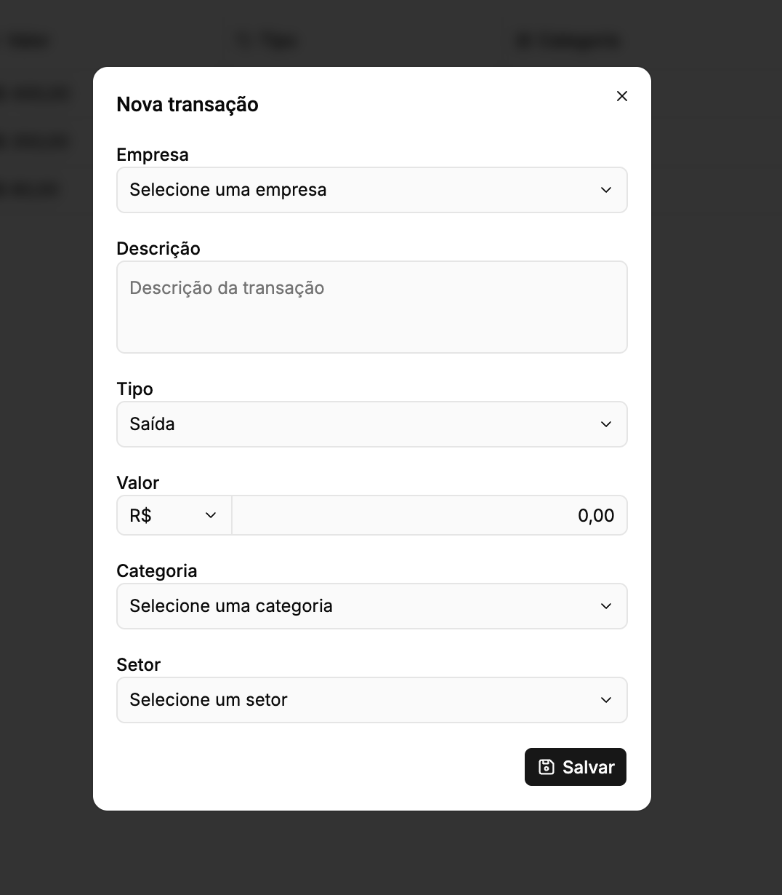

# Fintech Expenses
O Fintech Expenses permite que você insira suas transações financeiras, associe-as à empresas e contatos, e veja um resumo dos seus gastos. 

As transações podem ser de entrada ou de saída, e podem ser filtradas por diversos campos.

O sistema foi construído em NestJS e Node, em um monorepo que inclui um front-end em React com React Router V7. Ambos possuem deploy em sistema único no vercel:

[Acessar demo](https://fintech-expenses-challenge-i8lmgdldt-calebs-projects-98fa8f7b.vercel.app/)

O usuário padrão de administrador e a senha são, respectivamente, admin@admin.com e `&_Lo;0,J72GVh`.

## Especificações Técnicas
### Banco de dados
- O projeto possui TypeORM para sua conexão com o banco de dados e gerenciamento de entidades. Suporte para PostgreSQL. 
- As entidades de transação e categoria de transação foram agrupadas dentro do mesmo módulo, `Transactions`
### Segurança
- O projeto faz o hash de senhas usando Argon, padrão moderno de segurança. Informações confidenciais não são armazenadas.
- A autenticação proíbe por padrão, e valida tokens JWT enviados através de cokies `httpOnly`. As rotas de login têm exceção através do decorator `@Public`.
### Permissionamento
- O aplicativo possui um sistema de permissionamento hierárquico, com usuários sendo associados a `roles` que possuem permissionamento de `criação, leitura, atualização e exclusão` das entidades do sistema. Cada usuário pode também receber um esquema próprio de permissionamento que precederá o definido pelo seu `role`. Essa estrutura existe no código e já funciona, mas nem todas validações já existem no front-end ou em todos os endpoints.
### Workspace
- O monólito usa `pnpm` para gerenciar dependências compartilhadas e organizar os dois projetos. O `pnpm` oferece funcionalidade básica para monólitos sem poluir o projeto com funcionalidades que não serão utilizadas.
### React
- A interface foi montada com componentes do `shadcn`, e a fiação do roteamento foi feita com `React Router V7`.
- Context API supriu: o aplicativo não possui multi-workspaces, múltiplos logins, seleção de temas, etc. Portanto a autenticação e transferência simples de estado foi plena com uso de Context API e hooks simples.
---
## Rodar localmente
Você precisará do `postgreSQL` instalado na sua máquina, assim como o `pnpm` e o `node`. _O projeto foi testado em macOS e Linux_.

1. Copie o arquivo .env.TEMPLATE para .env e preencha os campos de acordo.
2. Execute `pnpm i`
3. Popule o banco de dados com as tabelas e usuário admin: `pnpm reset-db`
4. Rode o servidor NestJS e o servidor Vite: `pnpm run dev` (roda os dois em paralelo se executar na raíz do projeto)
5. Abra o site em seu navegador na url `localhost:5173`

### Déficits técnicos
- Devido ao tamanho do projeto e pouco tempo de realização, foi possível realizar demandas técnicas, mas testes unitários e de integração ficaram pendentes.
- O sistema de permissionamento não está totalmente implementado, porém se demonstrou ingratificante de se estender, apesar de efetivo. Se eu fosse seguir com o projeto, eu repensaria a abordagem.
- Alguns componentes do front-end não me satisfazem em "enxutez". Poderiam ser simplificados, dado mais tempo.
- Os filtros funcionam, porém a implementação é pouco geral. Não é possível compor filtros do mesmo tipo (transações de empresa x e transações de empresa y), por exemplo. O back-end possui o suporte para ordenar campos, mas essa funcionalidade ainda não foi mapeada no front-end.
- O servidor e front-end estão hospedados em uma conta Vercel gratuita, e o banco de dados está em uma instância gratuita da Neon. Portanto, a performance da demo online é insatisfatória.

### Uso de IA
- O Copilot foi usado pontualmente no desenvolvimento do projeto, principalmente em tarefas demoradas e de pouco retorno, como montagem de formulários e consulta de documentação. Não foi utilizada na tomada de decisões do projeto, pois na minha experiência pessoal tenho resultados insatisfatórios com os modelos modernos nesse âmbito. Alguns controllers e serviços foram programados pelo Copilot, usando como referência controllers que montei à mão e servem funcionalidade semelhante.
